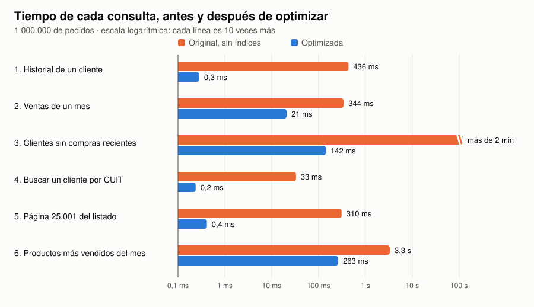

# Ezequiel Delipetro — Portfolio

🌐 **English** · [Español](README.md)

**Systems Developer** · SQL · API integrations · Process automation · Web & mobile development · Data analysis

I work as a developer in the Systems department at Digitrack, an Argentine company: I migrated the company's web application to a low-code platform, optimized the queries that were slowing it down, and automated ticket creation through an API. This repository gathers all my projects in one place.

📩 e.delipetro@gmail.com · [LinkedIn](https://www.linkedin.com/in/ezedelipetro/) · [Website](https://ezedeli.github.io/Proyectos/en.html) · **Available for freelance projects** · Based in Buenos Aires, Argentina (GMT-3), working remotely

---

## Featured case studies

| Project | What it is | Stack |
|---|---|---|
| [**SQL query optimization**](datos/optimizacion-sql/README.en.md) | Six typical slow queries on a database with 1 million orders, measured before and after: one went from over 2 minutes to 142 ms, with the exact same result. | SQL · MySQL / MariaDB · Python |
| [**Automated Excel loading**](automatizacion/carga-excel/README.en.md) | Each branch's spreadsheets load themselves into the database: every row is cleaned and validated, errors are set aside with the reason, and a summary email is sent. They used to be copied by hand. | Python · openpyxl · SQL · SMTP |
| [**CooperApp**](cooperapp/README.en.md) | Management system for cooperatives and small businesses: multiple companies on one platform, 4 roles, finances, stock and PDF/CSV reports. I was the lead developer of the team. *(private code: case study)* | Node.js · Express · MySQL · bcrypt |

## Other projects

*(documentation in Spanish)*

| Project | What it is | Stack |
|---|---|---|
| [**User management (CRUD)**](web/abm-usuarios-php) | Create, edit and delete users with login, protected against SQL injection, XSS and CSRF. | PHP · MySQL · Bootstrap |
| [**Fábregas**](mobile/fabregas) · [▶ Try the demo](https://ezedeli.github.io/Proyectos/demo/fabregas/) | Tech store app: catalog by section, product details, branches and profile. **Runs in the browser.** | React Native · Expo Router · NativeWind · TypeScript |
| [**Calculator**](mobile/calculadora) | Calculator with its own parser that respects operator precedence (no `eval`). | React Native · Expo · TypeScript |
| [**Weather data ETL**](datos/etl-clima) | Hourly pipeline: weather API → Pandas → data warehouse, with email alerts. | Python · Airflow · Docker · Redshift |
| [**Adidas sales**](datos/powerbi-adidas) | Data model and interactive sales and profitability dashboard, with a findings report. | Power BI · SQL |
| [**Wineries and wines**](datos/tableau-vinos) | Analysis of the Spanish wine market: KPIs, map by region and prices. | Tableau |
| [**Excel dashboard**](datos/excel-dashboard) | Construction budget and progress: pivot tables, charts and slicers. | Excel |

---

## How I can help

- **Databases:** slow queries, data cleaning, validations and modeling.
- **Automation:** integrations between systems through APIs, alerts, scheduled tasks, spreadsheet loading.
- **Custom web development**, front end and back end: internal systems, forms, admin panels.
- **ETL and reporting:** data from Excel, CSV or APIs organized in a database, and dashboards in Power BI.

I use AI-assisted development to deliver fast, and I always start by understanding the business rules. I work in English and Spanish.
