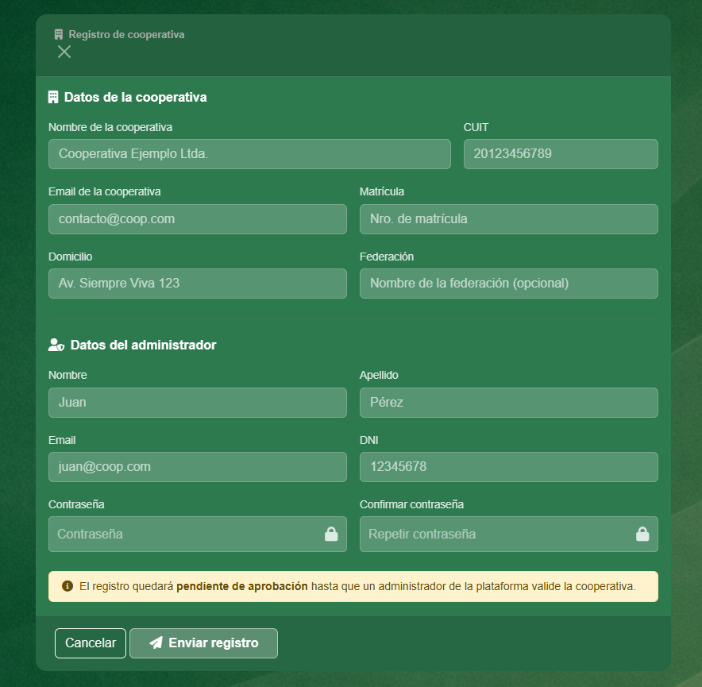

# Ezequiel Delipetro — Portfolio

**Desarrollador de Sistemas** · SQL · Integración de APIs · Automatización de procesos · Desarrollo web y mobile · Análisis de datos

Trabajo como desarrollador en el área de Sistemas de Digitrack: migré la aplicación web de la empresa a una plataforma low-code, optimicé las consultas que la trababan y automaticé la generación de tickets por API. En este repositorio están mis proyectos, todos en un solo lugar.

📩 e.delipetro@gmail.com · [LinkedIn](https://www.linkedin.com/in/ezedelipetro/) · [Web](https://ezedeli.github.io/Proyectos/) · **Disponible para proyectos freelance**

---

## Proyectos

### 🏢 Sistemas web

| Proyecto | Qué es | Stack |
|---|---|---|
| [**CooperApp**](cooperapp) | Sistema de gestión para cooperativas y pymes: varias empresas en una plataforma, 4 roles, finanzas, stock, servicios y reportes en PDF/CSV. Fui el desarrollador principal de un equipo. *(código privado: caso de estudio)* | Node.js · Express · MySQL · bcrypt |
| [**ABM de usuarios**](web/abm-usuarios-php) | Alta, baja y modificación de usuarios con login, protegido contra inyección SQL, XSS y CSRF. | PHP · MySQL · Bootstrap |

### 📱 Apps mobile

| Proyecto | Qué es | Stack |
|---|---|---|
| [**Fábregas**](mobile/fabregas) | App de tienda de tecnología: catálogo por secciones, detalle de producto, sucursales y perfil. | React Native · Expo Router · NativeWind · TypeScript |
| [**Calculadora**](mobile/calculadora) | Calculadora con parser propio que respeta la precedencia de operaciones (sin `eval`). | React Native · Expo · TypeScript |
| [**Prácticas**](mobile/practicas) | Seis ejercicios: estilos, imágenes, componentes con props, estado y navegación. | React Native · Expo |

  
  &nbsp;&nbsp;
  

### 📊 Datos

| Proyecto | Qué es | Stack |
|---|---|---|
| [**ETL de datos climáticos**](datos/etl-clima) | Pipeline que corre cada hora: API del clima → Pandas → data warehouse, con alertas por mail. | Python · Airflow · Docker · Redshift |
| [**Facturación de Adidas**](datos/powerbi-adidas) | Modelo de datos y dashboard interactivo de ventas y rentabilidad, con informe de conclusiones. | Power BI · SQL |
| [**Bodegas y vinos**](datos/tableau-vinos) | Análisis del mercado de vinos españoles: KPIs, mapa por región y precios. | Tableau |
| [**Dashboard en Excel**](datos/excel-dashboard) | Análisis y dashboard interactivo con tablas dinámicas y segmentadores. | Excel |

---

## Qué puedo hacer por vos

- **Desarrollo web a medida**, front-end y back-end: sistemas internos, formularios, paneles de gestión.
- **Bases de datos:** consultas lentas, limpieza de datos, validaciones y modelado.
- **Automatización:** integraciones entre sistemas por API, alertas, tareas programadas.
- **ETL y reportes:** datos de Excel, CSV o APIs ordenados en una base, y dashboards en Power BI.

Trabajo con desarrollo asistido por IA para entregar rápido, y siempre arranco entendiendo las reglas del negocio.
