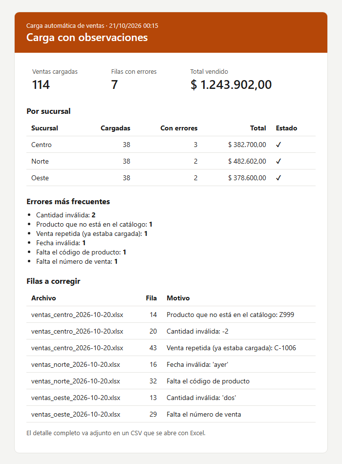

# De copiar Excel a mano a una carga automática con aviso por mail

🌐 **Español** · [English](README.en.md)

**El problema:** cada sucursal manda todos los días su planilla de ventas. Alguien de administración las abre, copia las filas a un Excel general o al sistema, y corrige lo que encuentra: fechas escritas de mil formas, importes con "$" y puntos, códigos que no existen, ventas repetidas. Lleva tiempo todos los días, y los errores que se escapan aparecen después en los reportes.

**La solución:** un proceso que corre solo cada 15 minutos. Toma las planillas nuevas, limpia y valida cada fila, carga las correctas en la base de datos, separa las que tienen errores con el motivo, y avisa por mail cómo salió.

<p align="center"></p>

## Qué hace

```
entrada/                 proceso.py                         base de datos
ventas_centro.xlsx  ─┐   1. Lee cada Excel                 ┌─► ventas (114 filas)
ventas_norte.xlsx   ─┼─► 2. Reconoce los encabezados       │
ventas_oeste.xlsx   ─┘   3. Limpia y valida cada fila ─────┼─► rechazos.csv (7 filas, con el motivo)
                         4. Carga todo el archivo junto    │
                         5. Mueve el Excel a procesados/   └─► mail con el resumen
```

- **Entiende cada planilla aunque esté armada distinto.** Una sucursal pone "Nro venta" y otra "N° de venta"; una "Cantidad" y otra "Cant.". El proceso reconoce los nombres de cada columna sin que nadie cambie su forma de trabajar.
- **Limpia lo que se puede limpiar:** fechas como texto o en otro formato (`20/10/2026`, `2026-10-20`, `20-10-26`), importes con signo y formato argentino (`$ 4.200,00`), códigos en minúscula o con espacios.
- **Rechaza lo que no se puede adivinar, y dice por qué:** producto que no está en el catálogo, cantidad negativa o escrita en letras, fecha "ayer", venta sin número o repetida. Esas filas van a un CSV que se abre con Excel, con el archivo, el número de fila y el motivo, para corregirlas en el origen.
- **No carga nada dos veces.** Cada venta tiene su número como clave, y cada archivo se registra con una huella de su contenido: si el mismo Excel vuelve a llegar, se avisa y no se carga.
- **Todo o nada por archivo.** Si algo falla a mitad de un Excel, ese archivo no queda cargado a medias. Y un archivo roto no frena a los demás.
- **Avisa por mail** con el total cargado, el detalle por sucursal, los errores más frecuentes y el CSV de rechazos adjunto. El asunto ya dice si hay algo para revisar.
- **Deja registro** de cada corrida en `salida/proceso.log`.

## Resultado con los archivos de ejemplo

Tres planillas de 40 ventas cada una, con 15 problemas cargados a propósito:

| Sucursal | Cargadas | Rechazadas | Corregidas solas |
|---|---:|---:|---|
| Centro | 38 | 3 (producto inexistente, cantidad negativa, venta repetida) | fecha como texto, importe "$ 4.200,00", fila vacía |
| Norte | 38 | 2 (fecha "ayer", sin código) | fecha en otro formato, código " a101 ", decimal con punto |
| Oeste | 38 | 2 (cantidad "dos", sin número de venta) | año con dos dígitos, importe "1.900" |

Ejemplo del archivo de rechazos: [ejemplo-rechazos.csv](capturas/ejemplo-rechazos.csv).

## Archivos

| Archivo | Qué hace |
|---|---|
| [proceso.py](proceso.py) | El proceso principal: busca archivos nuevos, carga, separa rechazos, mueve y avisa. |
| [validaciones.py](validaciones.py) | Las reglas de limpieza y validación de cada columna. |
| [aviso.py](aviso.py) | Arma el mail en HTML y lo manda por SMTP. Sin servidor configurado, lo guarda en `salida/mails/`. |
| [esquema.sql](esquema.sql) | Las tablas: productos, ventas y registro de archivos procesados. |
| [test_validaciones.py](test_validaciones.py) | Pruebas automáticas de las reglas de limpieza. |
| [generar_ejemplos.py](generar_ejemplos.py) | Crea las tres planillas de ejemplo con errores típicos. |

## Cómo probarlo

Requisitos: Python 3 y `openpyxl` (`pip install openpyxl`).

```bash
python generar_ejemplos.py   # crea entrada/ con 3 planillas y el catálogo
python proceso.py            # carga, separa rechazos y genera el mail en salida/mails/
python -m unittest           # corre las pruebas
```

Para que mande el mail de verdad, copiá `.env.example` como `.env` y completá los datos del servidor SMTP (Gmail, Outlook o el de la empresa).

## Cómo dejarlo corriendo solo

**Windows** (Programador de tareas), cada 15 minutos:

```bash
schtasks /create /tn "Carga de ventas" /sc minute /mo 15 /tr "python C:\carga-excel\proceso.py"
```

**Linux** (cron): `*/15 * * * * cd /opt/carga-excel && python3 proceso.py`

Si no hay archivos nuevos, el proceso termina en un segundo sin hacer nada.

## Adaptarlo a otro caso

La base es SQLite para que el ejemplo corra sin instalar nada. En una empresa se conecta a su base (MySQL, SQL Server, PostgreSQL) cambiando solo la conexión. Las mismas piezas sirven para planillas de stock, pagos, asistencia o pedidos: cambian las columnas y las reglas, el resto del proceso queda igual. Los archivos también pueden llegar por mail, por una carpeta compartida o desde una API, en lugar de una carpeta local.

---

¿Tu equipo pierde horas pasando datos de un lado a otro? Lo automatizo. **e.delipetro@gmail.com** · [LinkedIn](https://www.linkedin.com/in/ezedelipetro/) · [Web](https://ezedeli.github.io/Proyectos/)
