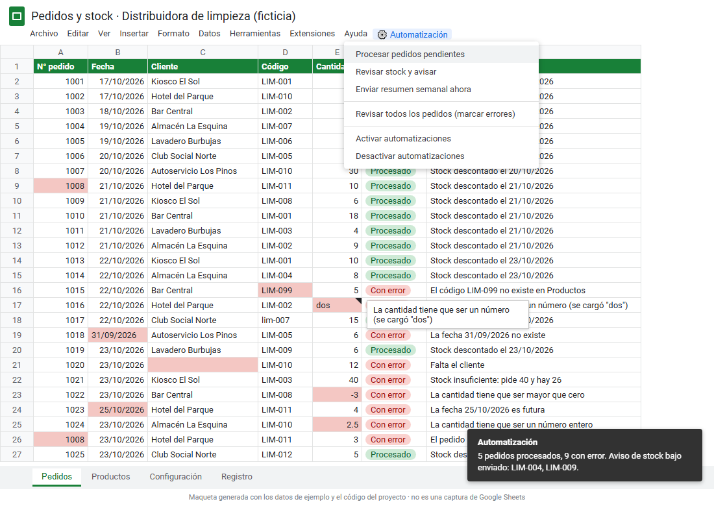
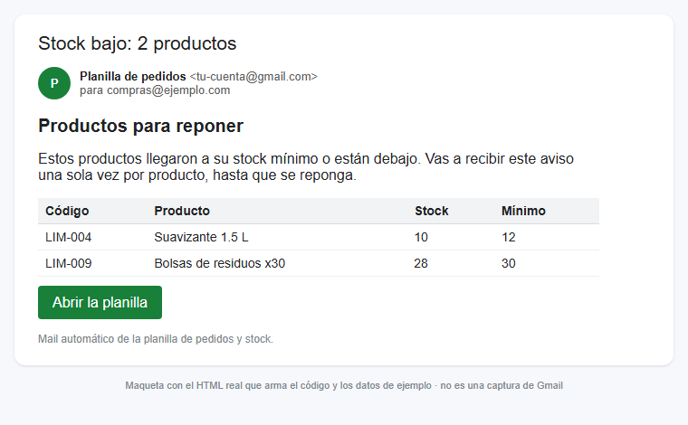
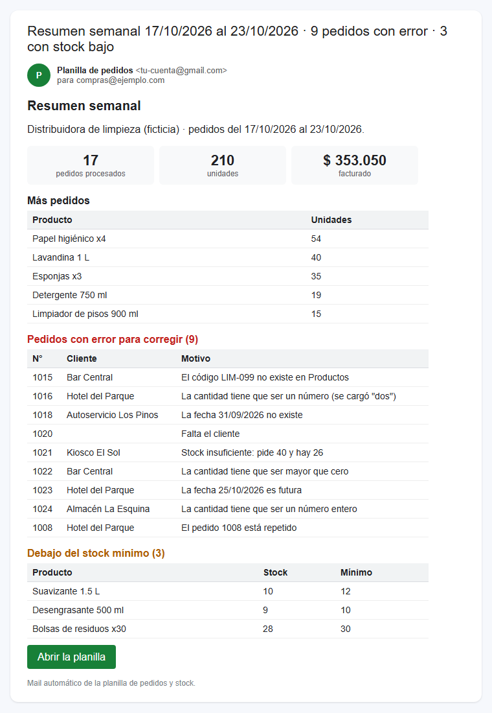

# An orders and stock spreadsheet in Google Sheets that checks itself

🌐 **English** · [Español](README.md)

**The problem:** many small businesses keep their orders and stock in a shared Google spreadsheet. It works, until someone enters a product code that doesn't exist, types "two" as the quantity or enters a date that doesn't exist. Nobody notices that a product is about to run out until it's gone, and to find out how the week went someone has to sit down and add things up.

**The solution:** the same spreadsheet, with a Google Apps Script inside it. It flags errors the moment they are entered, deducts stock for each order, emails an alert when a product reaches its minimum (only once, without flooding the inbox), sends a summary every Monday and writes everything it does to a log sheet. Nothing to install and no paid services: it runs on the company's own Google account.

<p align="center"></p>

> **About the images:** they are mockups generated by [capturas/maquetas.js](capturas/maquetas.js) from the demo data and the project's own code (statuses, notes and emails come from the real functions). They are not screenshots of Google Sheets or Gmail, and the data is made up: there is no real client behind it. The spreadsheet and the emails are in Spanish, as the target users are Spanish-speaking businesses.

## What it does

```
Someone enters an order ──► onEdit: validates the row instantly ──► red cell + note with the reason
                                                                    (or back to "Pending" once fixed)

Every hour (or from the menu):
  "Pending" orders ──► process ──► "Processed" + stock deducted
                              └──► "Error" + reason (code, quantity, date, customer, duplicate, out of stock)
  Products ──► stock ≤ minimum and not yet alerted? ──► "Low stock" email + "Alerted on ..." mark
           └─► restocked? ──► clears the mark, so it can alert again next time

Mondays 8:00 (or from the menu): weekly summary email

Everything ──► Log sheet: date, action, result (OK / ERROR / Skipped) and details
```

- **Validates while you type.** As soon as someone writes in the Orders sheet, any problem cell turns red with a note explaining why: the product code doesn't exist, the quantity is not a number, the date doesn't exist or is in the future. Pasting many rows at once checks them all. Once fixed, the red goes away by itself.
- **Processes orders and deducts stock**, in order. If there isn't enough stock it never goes negative: the order is marked as an error with "not enough stock: asks for 40, there are 26".
- **Low stock alerts without spam.** One email listing every product that reached its minimum, and a mark in the spreadsheet so the same product isn't reported again. When it is restocked, the mark is cleared automatically.
- **Weekly summary** with processed orders, units, revenue, top products, orders with errors to fix and products below their minimum. The subject line already says whether there is something to review.
- **Its own "⚙️ Automatización" menu** to run everything by hand and to turn the scheduled processes on or off.
- **A log of every run**, with errors in red. If an email fails (for example, because of Google's daily quota), it is logged and the product is not marked as alerted, so it is retried on the next run.
- **Never steps on itself:** a lock (`LockService`) prevents two simultaneous runs from deducting stock twice.
- **Configured from the spreadsheet:** alert recipients and the business name live in the Configuración sheet. No need to touch the code.

## The emails

<p align="center">
  
  &nbsp;
  
</p>

## Result with the demo data

The demo spreadsheet belongs to a fictional cleaning-supplies distributor: 12 products and 26 orders, 14 of them pending with errors added on purpose. After processing (`node demo.js` shows the same):

| Pending orders | Result |
|---|---|
| 1013, 1014, 1017, 1019, 1025 | **Processed** and stock deducted. Order 1017 had the code `" lim-007 "` in lowercase with spaces: it is accepted anyway. |
| 1015 | Error: product code LIM-099 doesn't exist |
| 1016 | Error: quantity "dos" ("two") |
| 1018 | Error: the date 31/09/2026 doesn't exist |
| 1020 | Error: missing customer |
| 1021 | Error: not enough stock (asks for 40, there are 26) |
| 1022 | Error: negative quantity |
| 1023 | Error: date in the future |
| 1024 | Error: quantity 2.5 (must be a whole number) |
| 1008 (second time) | Error: duplicated order number |

Then the stock check sends **one** email for the fabric softener and the garbage bags, which reached or dropped below their minimum. The degreaser is also low, but it had already been reported: no repeat. The hand sanitizer had an old mark and was restocked: the mark is cleared. A second run right after sends nothing.

## Files

| File | What it does |
|---|---|
| [Codigo.gs](Codigo.gs) | The Google side: menu, on-edit validation, processes, emails, triggers, lock and log. |
| [Validaciones.gs](Validaciones.gs) | Business rules and email building, with no Google dependencies, so they can be tested. |
| [appsscript.json](appsscript.json) | Project manifest: time zone and the minimum permissions it requests. |
| [planilla-ejemplo.xlsx](planilla-ejemplo.xlsx) | The spreadsheet to import into Google Sheets: Orders, Products and Settings. |
| [datos/](datos) | The same data as CSV. [generar_planilla.py](generar_planilla.py) builds the XLSX from it. |
| [demo.js](demo.js) | Runs the rules on the demo data without Google and saves the emails to `salida/`. |
| [test/](test) | Tests for the rules and for `Codigo.gs` against an in-memory fake spreadsheet. |
| [capturas/maquetas.js](capturas/maquetas.js) | Generates the images in this README. |

## How to install it

1. **Upload the spreadsheet.** In Google Drive: *New → File upload* → `planilla-ejemplo.xlsx`. Open it and choose *File → Save as Google Sheets*.
2. **Check the time zone.** *File → Settings*: locale and time zone (Argentina / Buenos Aires in the demo, or your own).
3. **Paste the code.** *Extensions → Apps Script*. Replace the contents of `Code.gs` with [Codigo.gs](Codigo.gs). With the **+** next to *Files*, add a script named `Validaciones` and paste [Validaciones.gs](Validaciones.gs). Save.
4. **(Optional) Manifest.** In *Project Settings* enable *Show "appsscript.json" manifest file* and replace it with [appsscript.json](appsscript.json): it sets the time zone and limits permissions to this spreadsheet.
5. **Reload the spreadsheet.** The **⚙️ Automatización** menu appears.
6. **Authorize.** The first time you use the menu, Google asks for permission to edit the spreadsheet, send emails and create triggers. Since it is your own script and not a published app, it shows *"Google hasn't verified this app"*: *Advanced → Go to (project name)*.
7. **Set up alerts.** In the Configuración sheet, fill in *Mails de aviso* (several separated by commas). If left empty, emails go to the account that enabled the script.
8. **Turn on the scheduled processes.** *⚙️ Automatización → Activar automatizaciones*: orders and stock every hour, summary on Mondays at 8. Validation on entry works from step 5, without turning anything on.

To use your own data, delete the demo rows and keep the column order.

**With [clasp](https://github.com/google/clasp)** (if you prefer the terminal): `clasp create --type sheets --title "Pedidos y stock"` in this folder, then `clasp push` uploads the `.gs` files and `appsscript.json`.

## How to test it without Google

Requirements: Node.js 18 or newer.

```bash
node --test                 # 15 tests: rules, emails and Codigo.gs against a fake spreadsheet
node demo.js                # processes the demo data and saves the emails to salida/
node capturas/maquetas.js   # regenerates the images (uses headless Microsoft Edge)
```

The rules live in `Validaciones.gs` with no dependency on `SpreadsheetApp`: Apps Script loads it like any other file, and Node imports it with `require`. That way the tests run in a second, with no Google account.

## Limits to keep in mind

- Google caps emails per day (100 on free Gmail accounts, 1,500 on Google Workspace). With one alert per product and one summary a week, that is plenty.
- `onEdit` validates what a person types. If orders come in through a Google Form or another integration, they are validated with a form trigger or when processing (which checks everything again before deducting stock).
- Google's hourly trigger doesn't run at an exact minute: it can shift a few minutes within the hour.

## Adapting it to other cases

The same pieces work for any shared spreadsheet that someone reviews by hand today: appointments, collections, attendance, multi-branch inventory, internal requests. The columns and the rules in `Validaciones.gs` change; the menu, the log, the lock and the emails stay the same. A Google Form for entering orders, a PDF per order or a connection to another system through an API can also be added.

---

Does your team work with Google spreadsheets that someone has to check by hand? I automate them. **e.delipetro@gmail.com** · [LinkedIn](https://www.linkedin.com/in/ezedelipetro/) · [Website](https://ezedeli.github.io/Proyectos/en.html)
