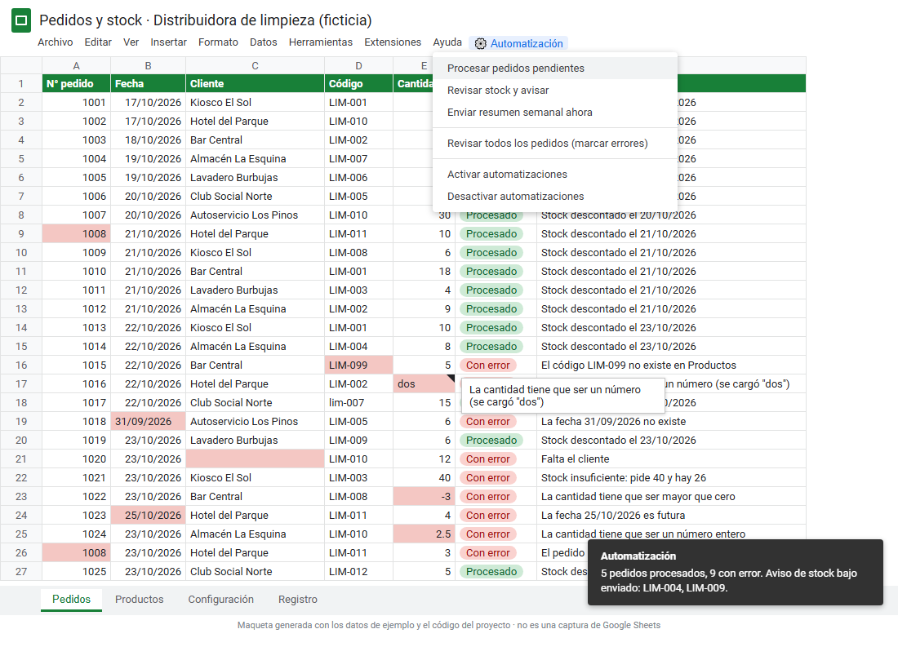
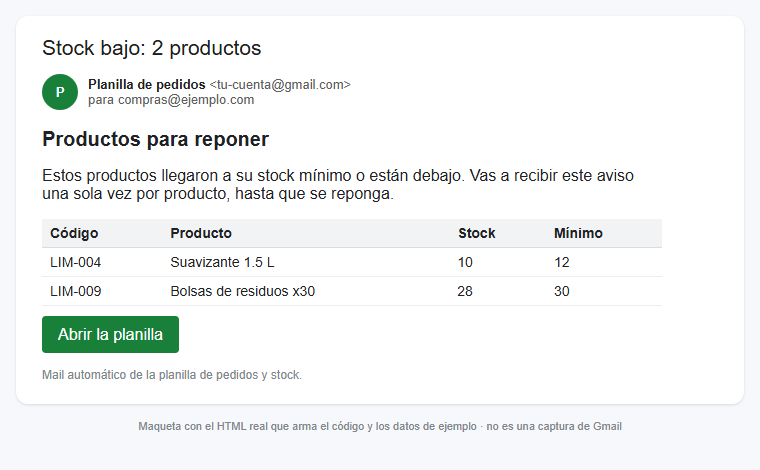
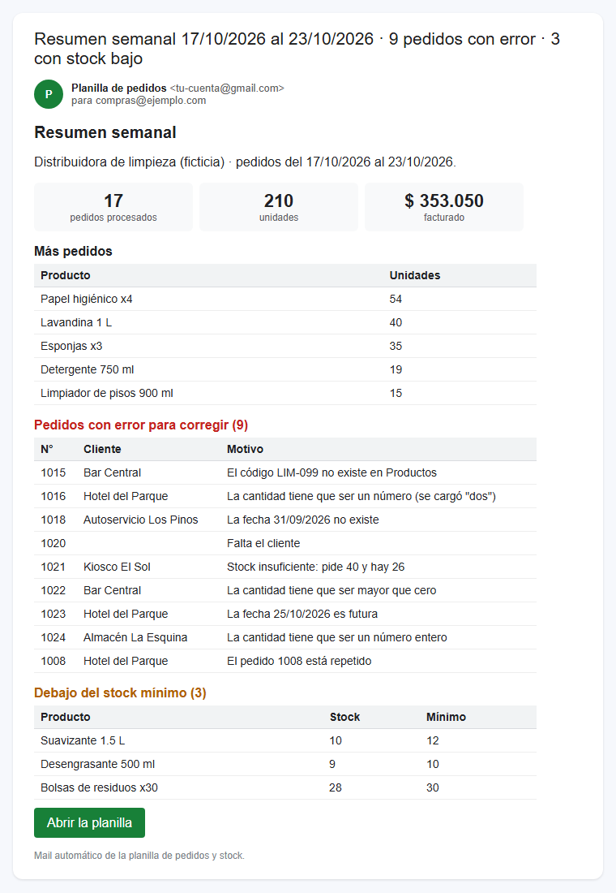

# Planilla de pedidos y stock en Google Sheets que se controla sola

🌐 **Español** · [English](README.en.md)

**El problema:** muchas pymes llevan los pedidos y el stock en una planilla de Google compartida. Funciona, hasta que alguien carga un código que no existe, escribe "dos" en la cantidad o pone una fecha que no existe. Nadie se entera de que un producto se está por terminar hasta que falta, y para saber cómo fue la semana alguien tiene que sentarse a sumar.

**La solución:** la misma planilla, con un script de Google Apps Script adentro. Marca los errores en el momento en que se cargan, descuenta el stock de los pedidos, avisa por mail cuando un producto llega a su mínimo (una sola vez, sin llenar la casilla de mails), manda un resumen todos los lunes y anota todo lo que hace en una hoja de registro. No hay que instalar nada ni pagar ningún servicio: corre en la cuenta de Google de la empresa.

<p align="center"></p>

> **Sobre las imágenes:** son maquetas generadas por [capturas/maquetas.js](capturas/maquetas.js) a partir de los datos de ejemplo y del mismo código del proyecto (los estados, las notas y los mails salen de las funciones reales). No son capturas de Google Sheets ni de Gmail, y los datos son inventados: no hay ningún cliente real detrás.

## Qué hace

```
Alguien carga un pedido ──► onEdit: valida la fila al instante ──► celda en rojo + nota con el motivo
                                                                   (o vuelve a "Pendiente" si se corrigió)

Cada hora (o desde el menú):
  Pedidos "Pendiente" ──► procesar ──► "Procesado" + descuenta stock
                                  └──► "Con error" + motivo (código, cantidad, fecha, cliente, repetido, sin stock)
  Productos ──► ¿stock ≤ mínimo y sin aviso? ──► mail "Stock bajo" + marca "Avisado el ..."
            └─► ¿se repuso? ──► borra la marca, para poder avisar la próxima vez

Lunes 8:00 (o desde el menú): resumen semanal por mail

Todo ──► hoja Registro: fecha, acción, resultado (OK / ERROR / Omitido) y detalle
```

- **Valida mientras se carga.** Apenas alguien escribe en la hoja Pedidos, la celda con problemas se pinta de rojo y queda una nota con el motivo: *"El código LIM-099 no existe en Productos"*, *"La cantidad tiene que ser un número (se cargó "dos")"*, *"La fecha 31/09/2026 no existe"*, *"La fecha 25/10/2026 es futura"*. Si pegan muchas filas juntas, las revisa todas. Al corregir, el rojo desaparece solo.
- **Procesa los pedidos y descuenta el stock**, en orden. Si no alcanza, no deja el stock en negativo: el pedido queda *"Con error: Stock insuficiente: pide 40 y hay 26"*.
- **Avisa el stock bajo sin spamear.** Un mail con todos los productos que llegaron a su mínimo, y una marca en la planilla para no volver a avisar del mismo producto. Cuando se repone, la marca se borra sola.
- **Resumen semanal** con los pedidos procesados, unidades, importe, los productos más pedidos, los pedidos con error para corregir y los productos debajo del mínimo. El asunto ya dice si hay algo para revisar.
- **Menú propio "⚙️ Automatización"** para correr todo a mano y para activar o desactivar los procesos automáticos.
- **Registro de cada ejecución**, con los errores en rojo. Si falla el envío de un mail (por ejemplo, por la cuota diaria de Google), queda anotado y el producto no se marca como avisado, así se reintenta en la próxima corrida.
- **No se pisa a sí mismo:** usa un candado (`LockService`) para que dos ejecuciones a la vez no descuenten el stock dos veces.
- **Se configura desde la planilla:** los mails de aviso y el nombre del negocio están en la hoja Configuración. No hace falta tocar el código.

## Los mails

<p align="center">
  
  &nbsp;
  
</p>

## Resultado con los datos de ejemplo

La planilla de ejemplo es de una distribuidora de artículos de limpieza ficticia: 12 productos y 26 pedidos, 14 de ellos pendientes y con errores cargados a propósito. Al procesar (`node demo.js` muestra lo mismo):

| Pedidos pendientes | Resultado |
|---|---|
| 1013, 1014, 1017, 1019, 1025 | **Procesados** y stock descontado. El 1017 tenía el código `" lim-007 "` en minúscula y con espacios: se acepta igual. |
| 1015 | Con error: el código LIM-099 no existe |
| 1016 | Con error: cantidad "dos" |
| 1018 | Con error: la fecha 31/09/2026 no existe |
| 1020 | Con error: falta el cliente |
| 1021 | Con error: stock insuficiente (pide 40, hay 26) |
| 1022 | Con error: cantidad negativa |
| 1023 | Con error: fecha futura |
| 1024 | Con error: cantidad 2.5 (tiene que ser entera) |
| 1008 (segunda vez) | Con error: número de pedido repetido |

Después, la revisión de stock manda **un** mail por el Suavizante y las Bolsas de residuos, que quedaron en su mínimo o debajo. El Desengrasante también está bajo, pero ya se había avisado: no se repite. El Alcohol en gel tenía una marca vieja y se repuso: la marca se borra. Una segunda corrida enseguida no manda nada.

## Archivos

| Archivo | Qué hace |
|---|---|
| [Codigo.gs](Codigo.gs) | La parte de Google: menú, validación al editar, procesos, mails, triggers, candado y registro. |
| [Validaciones.gs](Validaciones.gs) | Las reglas del negocio y el armado de los mails, sin nada de Google, para poder probarlas. |
| [appsscript.json](appsscript.json) | Manifiesto del proyecto: zona horaria y permisos mínimos que pide. |
| [planilla-ejemplo.xlsx](planilla-ejemplo.xlsx) | La planilla para importar en Google Sheets: Pedidos, Productos y Configuración. |
| [datos/](datos) | Los mismos datos en CSV. [generar_planilla.py](generar_planilla.py) arma el XLSX a partir de ellos. |
| [demo.js](demo.js) | Corre las reglas sobre los datos de ejemplo sin Google y guarda los mails en `salida/`. |
| [test/](test) | Pruebas de las reglas y de `Codigo.gs` contra una planilla simulada en memoria. |
| [capturas/maquetas.js](capturas/maquetas.js) | Genera las imágenes de este README. |

## Cómo instalarlo

1. **Subí la planilla.** En Google Drive: *Nuevo → Subir archivo* → `planilla-ejemplo.xlsx`. Abrila y elegí *Archivo → Guardar como Hojas de cálculo de Google*.
2. **Revisá la zona horaria.** *Archivo → Configuración*: configuración regional Argentina y zona horaria de Buenos Aires (o las tuyas).
3. **Pegá el código.** *Extensiones → Apps Script*. Reemplazá el contenido de `Código.gs` por el de [Codigo.gs](Codigo.gs). Con el **+** de *Archivos* agregá una secuencia de comandos llamada `Validaciones` y pegá [Validaciones.gs](Validaciones.gs). Guardá.
4. **(Opcional) Manifiesto.** En *Configuración del proyecto* activá *Mostrar el archivo de manifiesto "appsscript.json"* y reemplazalo por [appsscript.json](appsscript.json): fija la zona horaria y limita los permisos a esta planilla.
5. **Recargá la planilla.** Aparece el menú **⚙️ Automatización**.
6. **Autorizá.** La primera vez que uses el menú, Google pide permiso para editar la planilla, mandar mails y crear triggers. Como es un script propio y no una app publicada, muestra *"Google no verificó esta app"*: *Configuración avanzada → Ir a (nombre del proyecto)*.
7. **Configurá los avisos.** En la hoja Configuración, completá *Mails de aviso* (varios separados por coma). Si queda vacío, los mails van a la cuenta que activó el script.
8. **Activá los procesos automáticos.** *⚙️ Automatización → Activar automatizaciones*: pedidos y stock cada hora, y resumen los lunes a las 8. La validación al cargar funciona desde el paso 5, sin activar nada.

Para cargar tus propios datos, borrá las filas de ejemplo y respetá el orden de las columnas.

**Con [clasp](https://github.com/google/clasp)** (para quien prefiere trabajar desde la terminal): `clasp create --type sheets --title "Pedidos y stock"` en esta carpeta y `clasp push` sube los `.gs` y el `appsscript.json`.

## Cómo probarlo sin Google

Requisitos: Node.js 18 o más nuevo.

```bash
node --test                 # 15 pruebas: reglas, mails y Codigo.gs contra una planilla simulada
node demo.js                # procesa los datos de ejemplo y guarda los mails en salida/
node capturas/maquetas.js   # regenera las imágenes (usa Microsoft Edge sin ventana)
```

Las reglas viven en `Validaciones.gs` sin depender de `SpreadsheetApp`: Apps Script lo carga como un archivo más, y Node lo importa con `require`. Así las pruebas corren en un segundo y sin cuenta de Google.

## Límites a tener en cuenta

- Google limita los mails por día (100 en cuentas Gmail gratuitas, 1.500 en Google Workspace). Con un aviso por producto y un resumen por semana, sobra.
- `onEdit` valida lo que carga una persona. Si los pedidos entran por un Formulario de Google o por otra integración, se valida con un trigger de formulario o al procesar (que vuelve a revisar todo antes de descontar stock).
- El trigger por hora de Google no corre en un minuto exacto: puede variar unos minutos dentro de la hora.

## Adaptarlo a otro caso

Las mismas piezas sirven para cualquier planilla compartida que hoy alguien revisa a mano: turnos, cobranzas, asistencia, inventario de varias sucursales, solicitudes internas. Cambian las columnas y las reglas de `Validaciones.gs`; el menú, el registro, el candado y los mails quedan iguales. También se puede sumar un Formulario de Google para cargar pedidos, un PDF por pedido o la conexión con otro sistema por API.

---

¿Tu equipo trabaja con planillas de Google que alguien tiene que revisar a mano? Las automatizo. **e.delipetro@gmail.com** · [LinkedIn](https://www.linkedin.com/in/ezedelipetro/) · [Web](https://ezedeli.github.io/Proyectos/)
