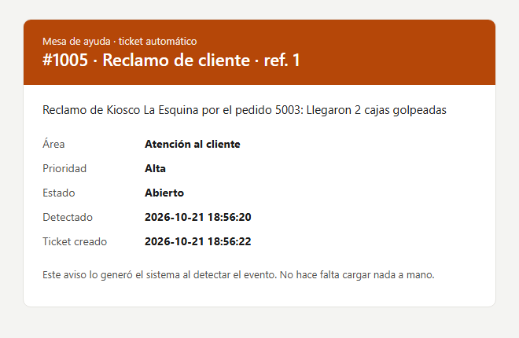

# Tickets automáticos por API: de "alguien se tiene que dar cuenta" a un aviso que llega solo

🌐 **Español** · [English](README.en.md)

**El problema:** cuando baja el stock, se demora un pedido o entra un reclamo, alguien tiene que darse cuenta, abrir un ticket en la mesa de ayuda y avisarle al área que corresponde. Si esa persona está ocupada, el aviso llega tarde o no llega.

**La solución:** la base de datos detecta los eventos sola, y un proceso los convierte en tickets llamando a la API del sistema de mesa de ayuda, con un mail al responsable. **El sistema que ya existe no se modifica**: solo se le agregan unos triggers.

<p align="center"></p>

## Cómo funciona

```
 Sistema existente            Base de datos                   worker.py                        Mesa de ayuda
 (no se toca)                                                                                  (API REST)
 vende, despacha,   ──►   tablas ──► TRIGGERS ──► eventos ──► lee pendientes ──► POST /tickets ──► ticket #1005
 registra reclamos                   (detectan)   (bandeja)   reintenta si falla                       │
                                                       ▲      guarda el n° de ticket ◄──────────────────┘
                                                       └───── y avisa por mail al área responsable
```

1. **Los triggers detectan los eventos** en la misma base: un producto que cruza el stock mínimo, un pedido que pasa a demorado, un reclamo nuevo. Los anotan en una tabla de eventos (patrón *outbox*). Solo avisan cuando hace falta: si el stock ya estaba bajo y se vende una unidad más, no se repite el aviso.
2. **El worker** lee los eventos pendientes, arma el ticket con la prioridad y el área de cada tipo, y lo crea por la API.
3. **Guarda el número de ticket** en el evento y le **manda un mail** al responsable (Compras, Logística o Atención al cliente).

## Lo que lo hace confiable

Conectar dos sistemas es fácil cuando todo anda bien. Lo importante es qué pasa cuando algo falla:

| Situación | Qué hace |
|---|---|
| La API responde con error 503 o 429 | Reintenta hasta 3 veces, esperando cada vez más (0,5 s, 1 s, 2 s). |
| La API está caída | El evento queda en error con el motivo, y se reintenta en la siguiente pasada (hasta 5 veces). No se pierde nada. |
| Se corta justo después de crear el ticket | Cada pedido lleva un `Idempotency-Key`: al reintentar, la API devuelve el mismo ticket en vez de crear otro. |
| Se corre el worker dos veces | Solo procesa los eventos pendientes. No duplica tickets ni mails. |
| El pedido está mal (4xx), por ejemplo un tipo de evento sin responsable | No reintenta en vano: lo marca para revisar, con el motivo. |
| Token inválido | La API lo rechaza (401) y el worker lo informa sin reintentar. |

## La demo

`python demo.py` corre todo sin configurar nada: levanta una mesa de ayuda simulada que **falla 1 de cada 3 pedidos**, simula un día de trabajo, corre el worker, corta la API a propósito y la vuelve a levantar. Salida resumida:

```
== 3. Corre el worker
  WARNING HTTP 503: Servicio no disponible (intento 1). Reintento en 0.2 s
  INFO    Evento 1 -> ticket #1001 (Compras)
  ...
   #  tipo            estado    intentos  ticket
   1  stock_bajo      enviado          1  #1001
   2  stock_bajo      enviado          1  #1002
   3  stock_bajo      enviado          1  #1003
   4  pedido_demorado enviado          1  #1004
   5  reclamo         enviado          1  #1005

== 4. Corre otra vez: no hay nada nuevo, no se duplica nada
  Tickets creados en esta pasada: 0. Tickets en la mesa de ayuda: 5

== 5. Se corta la API y entra un reclamo nuevo
   6  reclamo         error            1  -

== 6. Vuelve la API: el evento pendiente se envía en la siguiente pasada
   6  reclamo         enviado          2  #1006
```

La salida completa está en [capturas/salida-demo.txt](capturas/salida-demo.txt).

## Archivos

| Archivo | Qué hace |
|---|---|
| [esquema.sql](esquema.sql) | Tablas y los tres triggers que detectan los eventos. |
| [worker.py](worker.py) | Lee los eventos, crea los tickets por la API con reintentos e idempotencia, y avisa. |
| [aviso.py](aviso.py) | Arma el mail en HTML y lo manda por SMTP (o lo guarda en `salida/mails/` en modo demo). |
| [mesa_de_ayuda.py](mesa_de_ayuda.py) | API REST simulada de un sistema de tickets: token, validaciones, fallas al azar e `Idempotency-Key`. |
| [simular.py](simular.py) | Crea la base y simula un día de trabajo del sistema existente. |
| [demo.py](demo.py) | Demo de punta a punta, con la API fallando y cayéndose. |
| [test_integracion.py](test_integracion.py) | 8 pruebas: triggers, tickets, duplicados, reintentos, API caída, errores 4xx y token. |

Solo usa la biblioteca estándar de Python: no hay que instalar nada.

```bash
python demo.py               # la demo completa
python -m unittest           # las pruebas
python mesa_de_ayuda.py      # la API sola, en http://127.0.0.1:8765/api/v1/tickets
python worker.py --cada 60   # el worker revisando cada 60 segundos
```

## Llevarlo a un sistema real

- **La mesa de ayuda:** se cambia `API_URL` y `API_TOKEN` por los del sistema de tickets que use la empresa, y se adapta `armar_ticket()` a los campos que pide su API.
- **La base:** los triggers se escriben igual en MySQL, SQL Server o PostgreSQL. Si no se pueden agregar triggers, el worker puede consultar directamente las tablas cada tantos minutos.
- **Los avisos:** con los datos de SMTP en variables de entorno, los mails salen de verdad. Se pueden sumar otros canales (Teams, Slack, WhatsApp) con el mismo esquema.
- **Para que corra solo:** el Programador de tareas de Windows, cron o un servicio.

---

¿En tu empresa hay avisos que dependen de que "alguien se acuerde"? Los automatizo. **e.delipetro@gmail.com** · [LinkedIn](https://www.linkedin.com/in/ezedelipetro/) · [Web](https://ezedeli.github.io/Proyectos/)
