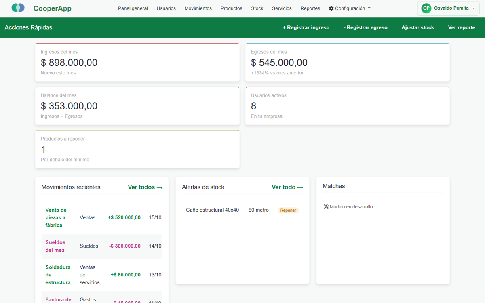
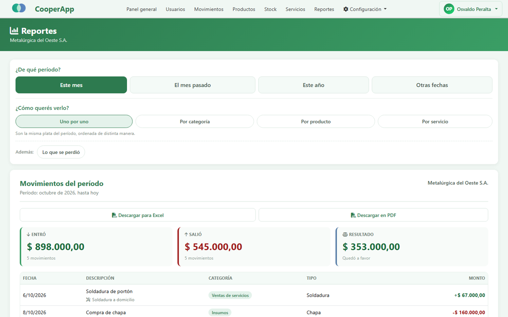
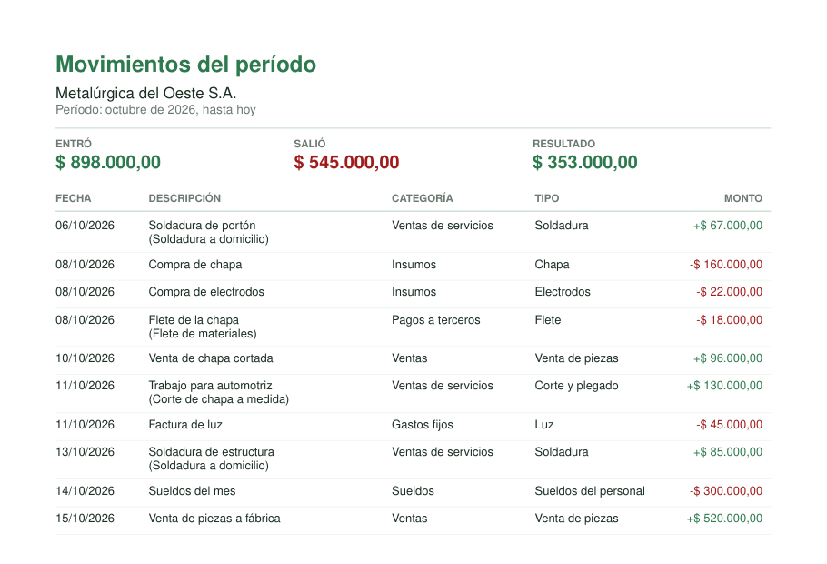
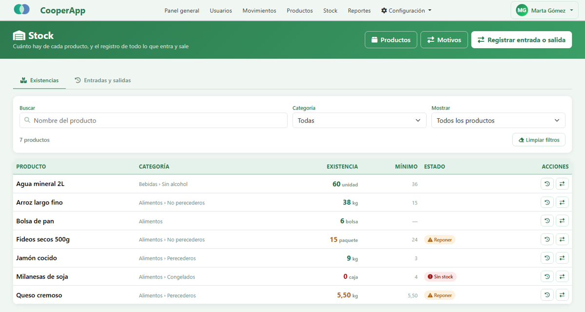
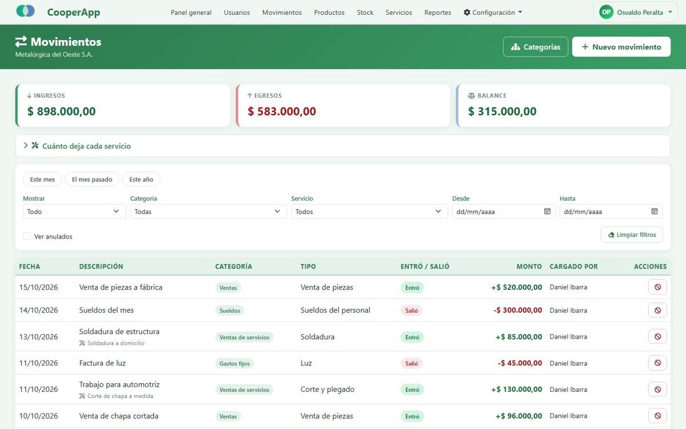
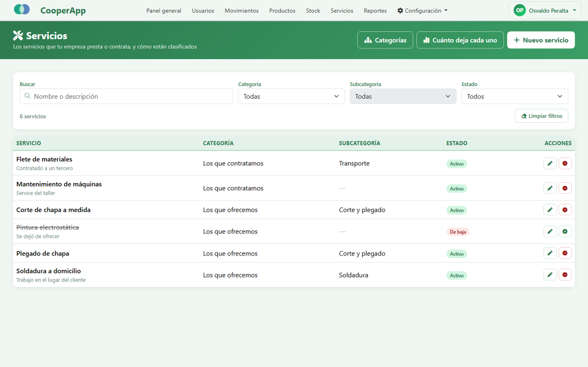
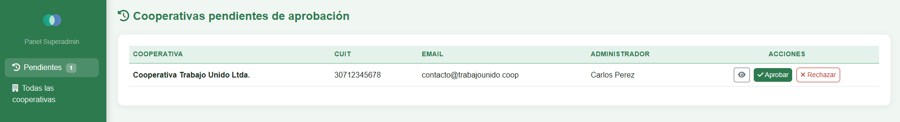
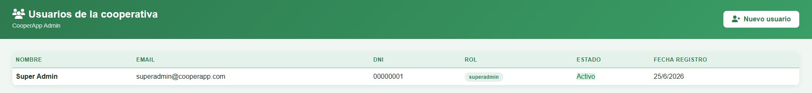
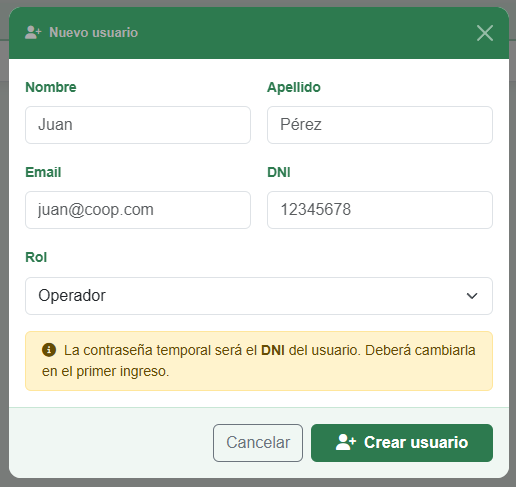

# CooperApp — Gestión para cooperativas y pymes

> **Código privado.** CooperApp puede convertirse en un producto comercial, así que acá muestro qué hace y cómo está construido, sin el código fuente. Si querés ver una demo en vivo, escribime.

Sistema web para que cooperativas y pequeñas empresas lleven su administración en un solo lugar: usuarios y permisos, finanzas, catálogo, stock, servicios y reportes descargables. Cada empresa ve solo sus datos y activa los módulos que necesita.

**Mi rol:** proyecto de la Tecnicatura Superior en Desarrollo de Software, hecho en equipo. Fui el **desarrollador principal**, con 29 de los 40 commits: diseño de la base de datos, backend, frontend, auditorías de QA y UX, y la organización del backlog en sprints. Usé desarrollo asistido por IA en todo el proceso.

## Capturas

> Datos de prueba de una empresa ficticia ("Metalúrgica del Oeste S.A.").

**Panel general**: indicadores del mes, últimos movimientos y alertas de stock.

**Reportes por período**: atajos de período, cuatro formas de agrupar y descarga en Excel y PDF.

| Reporte descargado en PDF | Stock calculado a partir de los movimientos |
|---|---|
|  |  |

| Movimientos de dinero | Catálogo de servicios |
|---|---|
|  |  |

<b>Alta de empresas y usuarios</b>

| Registro de una cooperativa | Panel del superadmin |
|---|---|
|  |  |

| Usuarios de la empresa | Alta de usuario |
|---|---|
|  |  |

## Qué hace

**Plataforma con varias empresas (multi-tenant)**
- Las empresas se registran solas y quedan pendientes hasta que un superadmin las aprueba. Al aprobarse, se les carga automáticamente la configuración inicial.
- Cada empresa está aislada de las demás: sus usuarios no pueden ver ni tocar datos de otra.
- Módulos que se prenden y apagan por empresa (finanzas, productos, servicios, reportes). El menú cambia según los módulos activos y **el servidor también lo controla**: escribir la URL a mano no saltea la restricción.

**Roles y permisos**
- 4 roles: superadmin, administrador, tesorero y operador. Cada uno ve solo lo suyo: el tesorero maneja la plata y el operador el depósito.
- Contraseñas con bcrypt, contraseñas temporales con cambio obligatorio en el primer ingreso, baja y reactivación de usuarios.
- En cada pedido se revisa el estado real del usuario: si lo dan de baja, pierde el acceso en ese momento, aunque tenga la sesión abierta.

**Finanzas**
- Ingresos y egresos con categorías y tipos. Los movimientos no se borran: se anulan, para no perder el historial.
- Resumen de ingresos, egresos y balance, que se recalcula con cada filtro.
- Cada movimiento puede indicar de qué servicio salió, para ver "cuánto deja cada servicio".

**Catálogo y stock**
- Productos y servicios con categorías y subcategorías.
- El stock no se guarda en ninguna columna: **se calcula sumando los movimientos**, así el historial siempre explica el número que se ve.
- Motivos de stock configurables (compra, venta, pérdida, robo), con validaciones para que no contradigan el efecto en el dinero.
- Control de concurrencia: si dos personas venden el mismo producto al mismo tiempo, el stock no queda en negativo.

**Reportes**
- Reportes por período: este mes, el mes pasado, este año o fechas a elección.
- Agrupados por categoría, producto o servicio, y un reporte de pérdidas valorizadas.
- Descarga en **CSV para Excel** (separador y decimales en formato argentino) y en **PDF** paginado, con encabezado repetido en cada hoja.

## Stack

| Capa | Tecnología |
|---|---|
| Backend | Node.js · Express 5 · express-session |
| Base de datos | MySQL / MariaDB, con consultas parametrizadas y modo estricto |
| Seguridad | bcrypt · sesiones `httpOnly` y `sameSite` · control de roles y módulos en el servidor |
| Frontend | HTML · CSS · JavaScript |
| Reportes | pdfkit (PDF) · CSV propio |

**Arquitectura:** rutas → middlewares (autenticación, rol y módulo) → controladores → servicios → modelos (SQL). Tiene unas 6.000 líneas de JavaScript en el backend.

## Cómo se trabajó

- **Backlog en sprints**, con historias de usuario. Al cierre de este caso iba por el Sprint 10.
- **Auditorías de QA y de UX** al final de cada par de sprints, con informes escritos. Cada hallazgo se convertía en una corrección. Por ejemplo: dos ventas simultáneas podían dejar el stock negativo, o la base de datos cortaba textos largos sin avisar.
- **Datos de prueba** con 4 empresas, 27 usuarios y los 4 roles, para que cualquiera del equipo pudiera reproducir cada caso.

---

**Ezequiel Delipetro** · [LinkedIn](https://www.linkedin.com/in/ezedelipetro/) · e.delipetro@gmail.com
