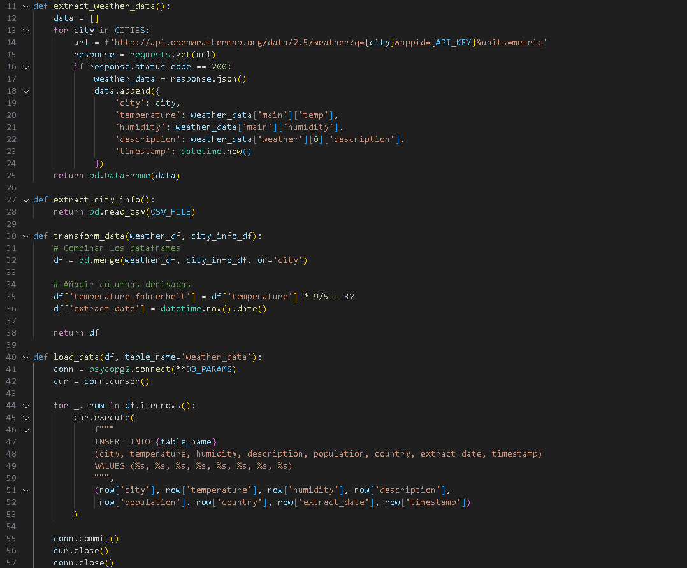
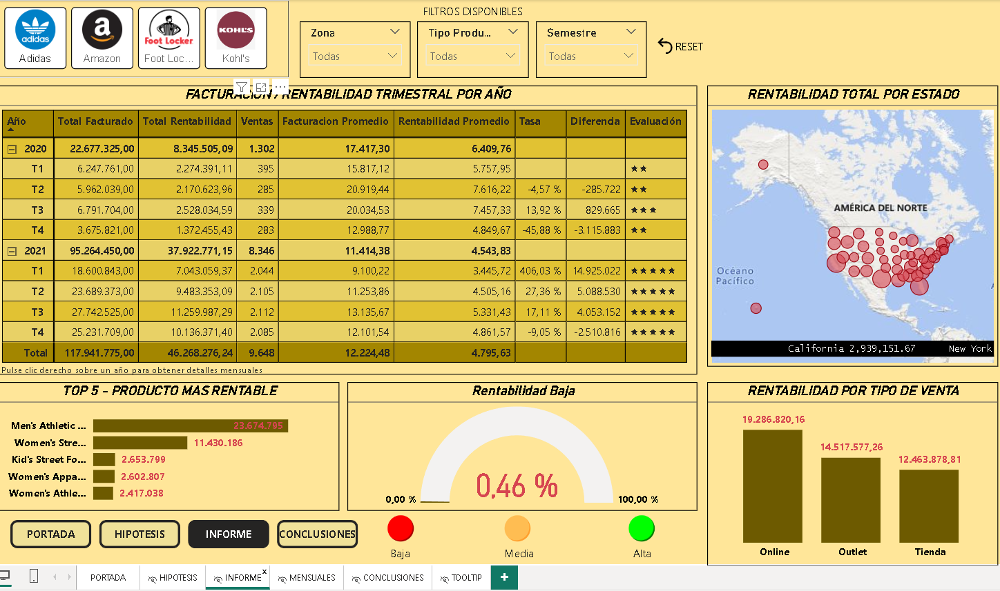
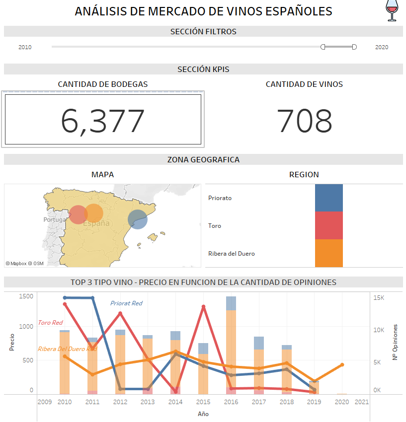
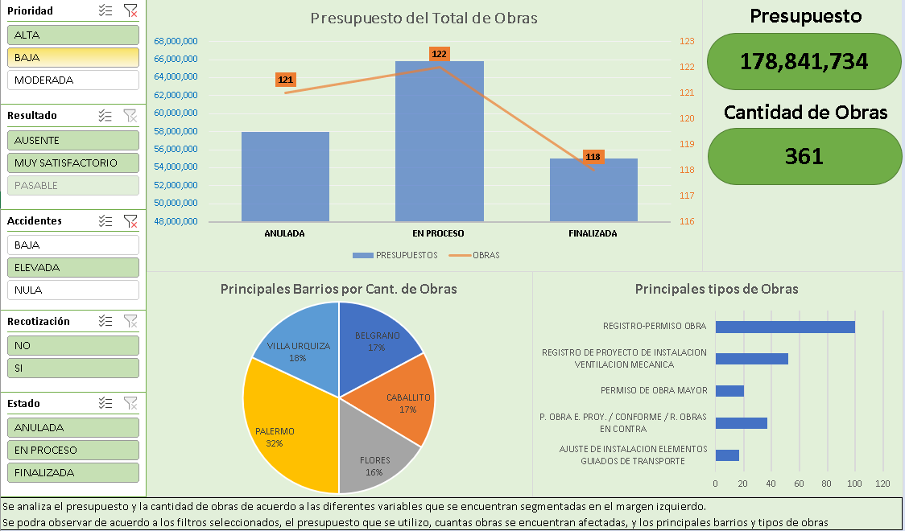

# Proyectos de datos

Proyectos de la formación en Data Analytics y Data Engineering (Coder House, 2024).

## ETL de datos climáticos — [`etl-clima`](etl-clima)



Un DAG de Airflow que corre cada hora y hace estos pasos:
1. **Extrae** el clima actual de varias ciudades desde la API de OpenWeatherMap.
2. **Cruza** esos datos con información de cada ciudad (población y país) usando Pandas.
3. **Carga** el resultado en un data warehouse (Amazon Redshift).
4. **Avisa por mail** cuando una ciudad pasa de los 30 °C.

Todo corre en Docker (Airflow + PostgreSQL para sus metadatos).

**Cómo levantarlo**
```bash
cp constants/constants.example.py constants/constants.py   # completar API key, base y mail
cp .env.example .env                                        # generar la clave de Airflow
docker compose up --build
```
La interfaz de Airflow queda en http://localhost:8080.

**Correcciones hechas al publicarlo**
- El Dockerfile buscaba `requirements.txt`, pero el archivo se llamaba `requierments.txt`. Además, faltaba `pandas` en la lista de dependencias.
- Las tareas se pasaban los datos con plantillas de Jinja, así que llegaban como texto en vez de DataFrame. Ahora viajan como JSON por XCom.
- Nunca se levantaba el scheduler de Airflow, y sin él el DAG no corre solo.
- La clave de cifrado de Airflow estaba escrita en el `docker-compose`. Ahora se lee de un `.env`, y las credenciales van en un archivo que no se sube al repo.

## Facturación y rendimiento de Adidas — [`powerbi-adidas`](powerbi-adidas)



Modelo de datos relacional (ventas, productos, regiones, vendedores y tipos de venta) y un dashboard con:
- facturación trimestral por año;
- rentabilidad por estado en un mapa;
- top 5 de productos más rentables;
- rendimiento por canal de venta.

Se puede filtrar por minorista, producto y semestre. Incluye un informe con las hipótesis y las conclusiones.
Para abrirlo: `facturacion-adidas.pbix` con Power BI Desktop.

## Bodegas y vinos de España — [`tableau-vinos`](tableau-vinos)



Análisis del mercado de vinos españoles, con:
- cantidad de bodegas y de vinos;
- mapa y distribución por región;
- evolución del precio según la cantidad de opiniones.

Se puede filtrar por año. Para abrirlo: `bodegas-y-vinos.twbx` con Tableau.

## Dashboard interactivo en Excel — [`excel-dashboard`](excel-dashboard)



Análisis de facturación y rentabilidad trimestral, con tablas dinámicas, segmentadores, mapa por estado y semáforo de rentabilidad.
