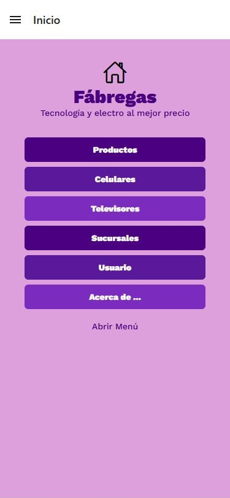

# Fábregas — App de tienda de tecnología

App móvil para una cadena ficticia de tiendas de tecnología y electrodomésticos. Permite recorrer el catálogo por categoría, ver el detalle de cada producto, consultar las sucursales y ver el perfil del cliente.

<p align="center">
  
</p>

## Qué hace

- **Catálogo en tres secciones** (Productos, Celulares y Televisores), con pestañas inferiores.
- **Detalle de cada producto** con ruta dinámica (`/celulares/[id]`). Si el id no existe, vuelve al listado.
- **Menú lateral (drawer)** propio, con Inicio, Productos, Sucursales, Usuario y Acerca de.
- **Sucursales** con dirección, horario y teléfono.
- **Precios con formato argentino** (`$ 1.099.999`).
- **Tipografía personalizada** (Work Sans) cargada antes de ocultar el splash.

## Stack

- React Native 0.86 + Expo SDK 57
- Expo Router: navegación por archivos, combinando drawer, tabs y stack
- NativeWind (Tailwind CSS para React Native)
- TypeScript

## Cómo está organizado

```
app/
  (drawer)/            menú lateral
    (tabs)/            pestañas del catálogo
      productos/       listado + [id] (detalle)
      celulares/
      televisores/
    inicio/  sucursales/  usuario/  acerca/
components/shared/
  StackSeccion.tsx     header y navegación de cada sección
  ListaProductos.tsx   listado reutilizable
  DetalleProducto.tsx  detalle reutilizable
  TarjetaProducto.tsx
store/                 catálogos y tipo Producto
```

Las tres secciones del catálogo comparten los mismos componentes: agregar una categoría nueva es crear su carpeta y su archivo de datos, sin copiar código.

## Cómo correrla

```bash
npm install
npx expo start
```

Después se abre con Expo Go en el celular, o con un emulador de Android o iOS.

---

Proyecto de la materia *Desarrollo de Aplicativos Móviles* — Tecnicatura Superior en Desarrollo de Software.
Desarrollado por **Ezequiel Delipetro** · [LinkedIn](https://www.linkedin.com/in/ezedelipetro/) · [Portfolio](https://ezedeli.github.io/Proyectos/)
