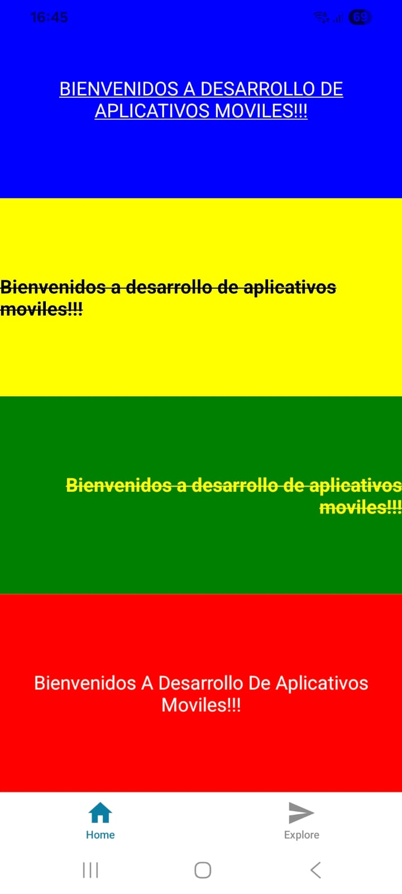
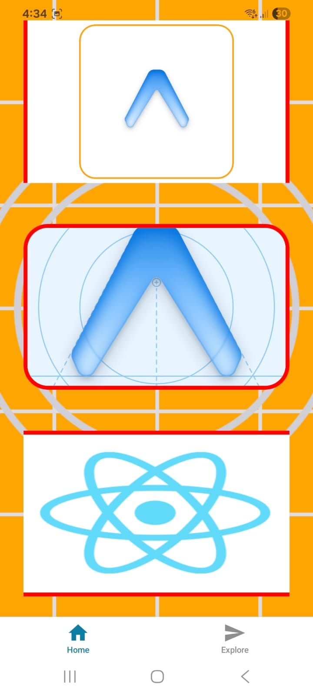
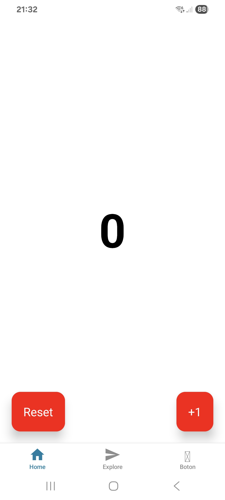
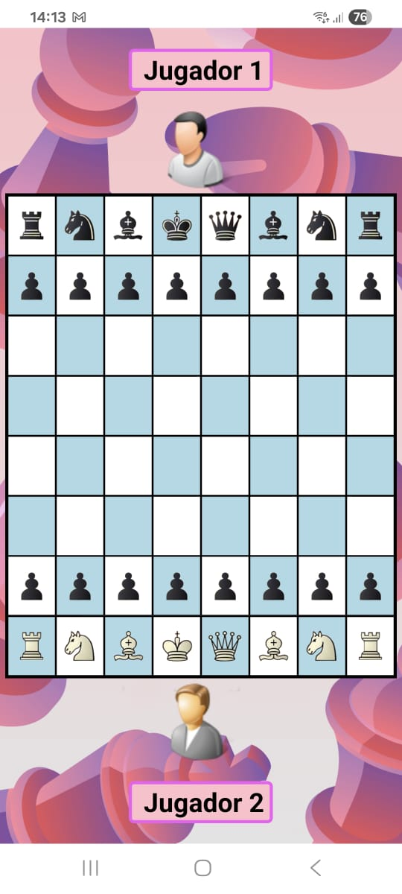

# Prácticas de React Native

Ejercicios de la materia *Desarrollo de Aplicativos Móviles*, ordenados de menor a mayor complejidad: estilos, imágenes, maquetado de una pantalla real, estado y componentes, y navegación.

Las apps más completas están en sus propias carpetas:
- [Fábregas](../fabregas): tienda con catálogo, detalle y menú lateral.
- [Calculadora](../calculadora): con parser propio de operaciones.

| # | Ejercicio | Qué practica | Captura |
|---|---|---|---|
| 01 | [Estilos](01-estilos) | `StyleSheet` vs. estilos en línea, flexbox, decoración de texto |  |
| 02 | [Imágenes](02-imagenes) | `Image`, `ImageBackground`, modos de `resizeMode`, bordes |  |
| 03 | [Billetera virtual](03-billetera-virtual) | Maquetado de la home de una app de pagos con estilos globales |  |
| 04 | [Contador](04-contador) | `useState`, componente `Boton` reutilizable con props tipadas, `Pressable` (toque y toque largo) |  |
| 05 | [Tablero de ajedrez](05-tablero-ajedrez) | Componente `Casilla`, tablero generado por código |  |
| 06 | [Navegación con Expo Router](06-navegacion-expo-router) | Drawer + tabs + stack anidados, ruta dinámica `[id]`, NativeWind | — |

## Cómo correrlos

- **05 y 06** son proyectos completos:
  ```bash
  cd 05-tablero-ajedrez   # o 06-navegacion-expo-router
  npm install
  npx expo start
  ```
- **01 a 04** son la pantalla principal de cada ejercicio. Se pegan en un proyecto creado con `npx create-expo-app`. Las imágenes que usan son las de esa plantilla.

## Correcciones hechas al publicar

- **03 y 04:** los imports apuntaban a rutas que no existían en la entrega.
- **04:** faltaba importar `SafeAreaProvider` y `SafeAreaView`.
- **05:** el rey y la reina estaban intercambiados (la reina va en la columna d), los peones blancos usaban la imagen del peón negro, y las 64 casillas, que estaban escritas una por una, ahora se generan con un bucle.
- **06:** el botón "Abrir menú" no hacía nada, porque le faltaban los paréntesis a `DrawerActions.toggleDrawer()`.

---

Tecnicatura Superior en Desarrollo de Software.
Desarrollado por **Ezequiel Delipetro** · [LinkedIn](https://www.linkedin.com/in/ezedelipetro/) · [Portfolio](https://ezedeli.github.io/Proyectos/)
