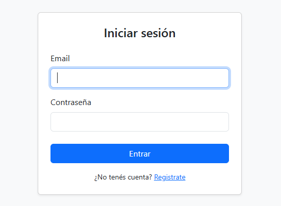
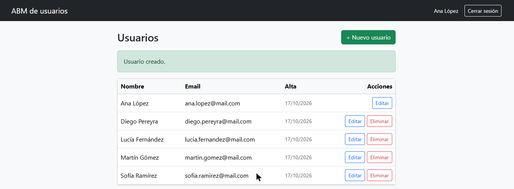

# ABM de usuarios — PHP y MySQL

Sistema de alta, baja y modificación de usuarios, con registro e inicio de sesión. Es un proyecto chico, pero hecho con las prácticas de seguridad que tiene que tener cualquier sistema con login.

| Login | Usuarios |
|---|---|
|  |  |

## Qué hace

- Registro e inicio de sesión.
- Listado, alta, edición y baja de usuarios. Un usuario no puede eliminarse a sí mismo.
- Validaciones: campos obligatorios, formato de email, contraseña de al menos 6 caracteres y email único.
- Interfaz con Bootstrap 5, con mensajes de éxito y de error.

## Seguridad

| Riesgo | Cómo se resuelve |
|---|---|
| **Inyección SQL** | Todas las consultas son preparadas (`prepare` + `bind_param`). Ningún dato del usuario se concatena al SQL. |
| **Contraseñas expuestas** | Se guardan hasheadas con `password_hash` (bcrypt) y se verifican con `password_verify`. |
| **XSS** | Todo lo que se muestra pasa por `htmlspecialchars`. Un nombre como `<script>…</script>` se ve como texto. |
| **CSRF** | Cada formulario que modifica datos lleva un token aleatorio, que se compara con `hash_equals`. |
| **Borrado con un link** | Eliminar solo funciona por POST con token: un enlace o una imagen de otro sitio no pueden borrar. |
| **Fijación de sesión** | Se regenera el ID de sesión al iniciar sesión. Las cookies son `HttpOnly` y `SameSite=Lax`. |
| **Enumeración de usuarios** | El login responde lo mismo si el email no existe o si la contraseña está mal. |
| **Errores internos a la vista** | Los errores de la base se guardan en el log y al usuario se le muestra un mensaje genérico. |

## Estructura

```
config/conexion.php    conexión (lee variables de entorno; por defecto usa la de XAMPP)
includes/funciones.php sesión, escape, CSRF, validaciones, alta de usuario
includes/encabezado.php, pie.php   plantilla común
login.php  registro.php  dashboard.php
usuarios.php  crear.php  editar.php  eliminar.php  logout.php
database.sql           estructura de la base
```

## Cómo correrlo

1. Prender MySQL (por ejemplo, desde XAMPP) y crear la base:
   ```bash
   mysql -u root < database.sql
   ```
2. Levantar el servidor:
   ```bash
   php -S localhost:8000
   ```
3. Entrar a http://localhost:8000 y registrarse.

---

Proyecto de la Tecnicatura Superior en Desarrollo de Software. La primera versión fue una entrega de la materia; esta es la versión revisada, con las correcciones de seguridad y la interfaz nueva.
